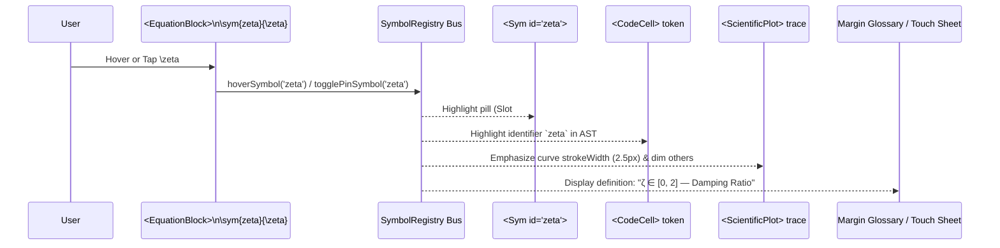

# System Architecture (`@academic-ds/core`)

This document specifies the structural topology, reactive state buses, and multi-axis adaptation model of the design system.

---

## 1. Four-Layer Architectural Stack

```mermaid
flowchart TB
    subgraph L4["L4: Application Shells & 'The Codex' Workbench"]
        S1["Compute Engine Shell\n(Wolfram Pod Stack)"]
        S2["Monograph Shell\n(Tufte 3-Col + Margin)"]
        S3["Notebook IDE Shell\n(Bracketed DAG Cells + AI Rail)"]
        S4["The Codex\n(Custom Storybook & X-Ray Stage)"]
    end

    subgraph L3["L3: Six Domain Primitive Pillars (28 Components)"]
        P1["1. Pod & Parametric\nPod • Manipulate • Scrubber • OmniBar"]
        P2["2. Math & Formal\nEquationBlock • FormalBlock • Proof • Algo"]
        P3["3. Prose & Citations\nCite • CitationCard • CrossRefLens • Sidenote"]
        P4["4. Science & DataVis\nFigure • ScientificPlot • BooktabsTable • Unit"]
        P5["5. Code & Notebooks\nCodeCell • ExecutionGutter • DataFrame"]
        P6["6. Grounded AI Copilot\nGroundingChip • VerificationBadge • Trace"]
    end

    subgraph L2["L2: Headless Academic State & Reactivity Engines"]
        E1["SymbolRegistry Bus\n(Cross-modal variable linking)"]
        E2["DocumentRegistry\n(Auto-counters & CrossRef AST lookup)"]
        E3["SidenotePacker\n(Collision-free 1D margin solver)"]
        E4["AdaptiveEnvironment\n(Density × Chroming × Theme × Pointer)"]
    end

    subgraph L1["L1: StyleX Token Contracts & Optical CSS Foundation"]
        T1["Materiality Tokens\n(OKLCH Paper, Carbon Ink, Multiply Blends)"]
        T2["Quad-Font Optical Lock\n(NewCM Book + KaTeX + Inter + JetBrains Mono)"]
        T3["TeX & Booktabs Grammar\n(em Spaces, 0.08em/0.05em Rules, Math Struts)"]
        T4["Container & Pointer Rules\n(@container pod/manuscript, Vernier Touch)"]
    end

    L4 --> L3
    L3 --> L2
    L2 --> L1
```

---

## 2. The Three Orthogonal Adaptation Axes

A core requirement of `@academic-ds/core` is that it must feel purposefully built for a **Wolfram Alpha query engine**, a **Distill/LaTeX academic paper**, a **Mathematica/Jupyter notebook**, or a **high-density laboratory dashboard** without duplicating components.

We achieve this by separating **Component Semantics** from **Presentation Context** along three orthogonal axes:

### Axis 1: `chroming` (`'framed' | 'seamless' | 'bracketed'`)
Controls how [`<Pod>`](./src/primitives/pod/Pod.tsx) and block primitives demarcate boundaries:

| Mode | Visual Behavior | Target Archetype |
| :--- | :--- | :--- |
| **`framed`** | Crisp `#FFFFFF` elevated plate (`paper.plate`), `1px` hairline border, subtle header bar with domain badge (`SYMBOLIC`, `EXACT`), representation switcher, and assumption strip. | Wolfram Alpha query results, scientific dashboards, AI synthesis cards. |
| **`seamless`** | Outer borders and header backgrounds dissolve; pods merge into the continuous `#FAF8F5` archival cotton paper canvas separated by TeX vertical rhythm and `0.05em` hairlines. | LaTeX papers, Distill.pub interactive essays, documentation, textbooks. |
| **`bracketed`** | Attaches hierarchical right-edge geometric cell brackets (Mathematica style) and `In[n]:=` / `Out[n]=` execution labels to each block. | Computational notebooks, symbolic CAS workbenches, literate programming. |

### Axis 2: `density` (`'manuscript' | 'workbench' | 'compact'`)
Implemented via StyleX sub-themes in [`themes.stylex.ts`](./src/tokens/themes.stylex.ts):

| Token | `manuscript` | `workbench` (Default) | `compact` |
| :--- | :--- | :--- | :--- |
| `proseSize` | `18px` | `16px` | `14px` |
| `proseLineHeight` | `1.58` (`28px` step) | `1.50` (`24px` step) | `1.40` (`20px` step) |
| `chromeSize` | `12.5px` | `12px` | `11px` |
| `monoSize` | `14px` | `13px` | `12px` |
| `podPadding` | `22px` | `14px` | `10px` |
| `podGap` | `20px` | `12px` | `8px` |

> **Subtree Mixing:** Because StyleX themes compile to scoped CSS classes, an application can render its primary center canvas in `densityManuscript` while rendering its docked AI Copilot and Symbol Inspector rails in `densityCompact`.

### Axis 3: `material` & `voice` (Theme Contracts)
Consumers can swap surface materiality, brand accents, and typographic voice independently:
* **Materiality Presets:** `archival-wolfram` (Warm `#FAF8F5` paper + Wolfram Vermilion & Prussian Blue), `swiss-lab` (Cool clinical `#F9FAFB` + CERN Cobalt), `oxford-monograph` (Warm library sepia).
* **Voice Presets:** `latex-classic` (`NewComputerModern Book` serif prose) vs. `neo-grotesque` (`Inter` sans-serif prose for engineering/SaaS apps that still need LaTeX math and Booktabs tables).

---

## 3. L2 State Engines & Cross-Modal Reactivity

### A. The `SymbolRegistry` Bus ([`src/core/registry.tsx`](./src/core/registry.tsx))

In scientific interfaces, the biggest cognitive tax is mapping a symbol $\zeta$ in an equation to its prose description, its parameter name `zeta` in code, and its trajectory in a figure.

* **KaTeX DOM Injection:** Our math renderer expands `\sym{id}{expr}` into `\htmlData{symbol-id=id}{expr}` (or wraps the rendered KaTeX span with `data-symbol-id="id"`), making individual sub-expressions inside complex integrals interactive without breaking TeX kerning.
* **Subtractive Ink Rendering:** Active symbol highlights apply `background-color: var(--sym-bg)` with `mix-blend-mode: multiply`, ensuring the black carbon glyph (`#141413`) never loses contrast.

### B. The `DocumentRegistry` & Non-Jumping `<CrossRef>` Engine

Traditional academic PDFs force readers to click `See Theorem 2.1` and jump 12 pages backward, losing their reading context.
1. Every `<FormalBlock>`, `<EquationBlock>`, `<Figure>`, `<BooktabsTable>`, and `<Section>` registers its `id`, hierarchical number (`Theorem 2.1`, `Eq. (1.2)`), title, and preview AST in `DocumentRegistry`.
2. When `<CrossRef to="thm:lyapunov" />` renders:
   * It resolves the human-readable label `"Theorem 2.1"` automatically.
   * **On Fine Pointers (Mouse):** Hovering opens a floating `<CrossRefLens>` directly above the link, rendering the theorem or equation in-place on a crisp `#FFFFFF` glass plate.
   * **On Coarse Pointers (Touch):** Tapping opens the non-modal **Academic Inspection Sheet** at the bottom of the viewport.

### C. Collision-Free Margin `SidenotePacker`

In `manuscript` layouts (`>= 960px` container width), citations, footnotes, and margin micro-figures project into the `28ch` right-hand column aligned with their inline anchor:
* If multiple anchors occur within a few lines, a 1D vertical packing pass ensures `top(note[i]) = max(anchorY(note[i]), bottom(note[i-1]) + 8px)`.
* When the container narrows below `960px` (`@container manuscript (max-width: 960px)`), margin notes seamlessly collapse into inline disclosure drawers or touch sheets.
